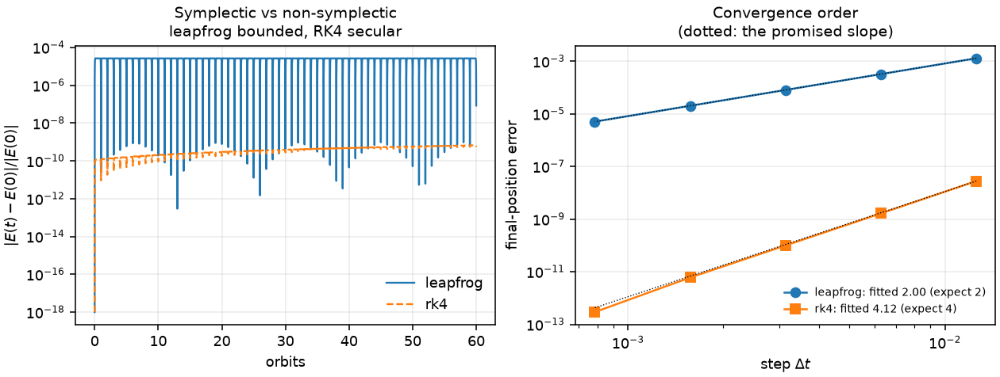

# Computational Physics Verification Lab

Four small physics modules, each one built to answer a single question about
every number it produces: **what independent fact says this is right?**

Quantum spin systems, statistical mechanics, photonics and classical
trajectories — each with the derivation written out, a Python implementation,
plots that carry the comparison rather than just the simulation, limiting cases
checked against closed forms, and a numerical error report regenerated on every
CI run.

```
4 modules · 723 tests · 7 figures
worst disagreement between two independent methods:  2.4e-13
tightest algebraic identity (Hong-Ou-Mandel zero):   4.9e-32
```

## Quick start

```bash
pip install -r requirements.txt
```

```bash
python -m pytest tests/ -q
```

```bash
python scripts/error_report.py && python scripts/make_figures.py
```

## The four modules

### 1. [Quantum spin systems](docs/01-quantum-spin.md)

Spin-`s` operators from the ladder operators, Heisenberg/XXZ/Ising chains,
exact diagonalisation, state probabilities, unitary time evolution and thermal
density matrices.

Verified by: the SU(2) algebra to `1.6e-15`, `S² = s(s+1)` to `1.8e-15`,
`tr H = 0` exactly, the singlet/triplet spectrum `−3J/4` and `J/4 − hm` to
`1.1e-16`, and Rabi precession against `½cos(ht)` to `3.9e-16`.

### 2. [Statistical physics](docs/02-statistical-physics.md)

Partition functions and thermodynamic observables for small Ising rings, by
brute-force enumeration of all `2^N` states **and** by transfer matrix.

Verified by: the two methods agreeing to `2.4e-13` across 384 parameter
combinations; `S → N ln 2` and `S → ln 2` in the two temperature limits;
`m = tanh(βh)` at zero coupling to `1.4e-16`; and the fluctuation formula
`C = β²Var(E)` against `C = dU/dT`.

### 3. [Photonics](docs/03-photonics.md)

Beam splitters, phase shifters, Mach-Zehnder interferometers and two-photon
interference, all as 2×2 matrix calculations.

Verified by: unitarity (which *is* energy conservation) to `2.2e-16`; the
interferometer output against `(sin²(φ/2), cos²(φ/2))` to `4.4e-16`; the
coincidence probability against `(T−R)²`; and the Hong-Ou-Mandel dip, which is
an **algebraic zero** rather than a small number — measured `4.9e-32`.

### 4. [Trajectories](docs/04-trajectories.md)

A charged particle in electromagnetic fields (Boris push and RK4) and the
gravitational two-body problem (velocity Verlet and RK4).

Verified by: gyrofrequency and gyroradius against `|q|B/m` and `mv⊥/(|q|B)`;
the `E × B` drift; Kepler's third law and the vis-viva relation; conserved
energy and angular momentum; and fitted convergence orders of 2.000, 4.118 and
2.000.

## How things are verified

Four kinds of evidence, in descending order of strength — set out in full in
[docs/00-verification-methodology.md](docs/00-verification-methodology.md):

1. **Exact algebraic identities**, checked at `~1e-12`: commutators,
   unitarity, trace identities. Anything larger is a bug, not a tolerance
   question.
2. **Closed forms**, compared term by term over a parameter range rather than
   at one point.
3. **Two independent methods** for the same quantity — the strongest evidence
   where no closed form covers the general case.
4. **Convergence order**, fitted from the measured error. This is the check a
   plot cannot replace.

The last point is the reason the repository exists. An integrator can produce a
visually perfect closed orbit and still be first order; the only way to find out
is to halve the step and measure the exponent.

## What measuring caught

Four real errors surfaced during development, each in work that looked correct:

**A first-order Boris push.** The velocity update was textbook; the position
was advanced as `x += Δt·v_new` rather than with a half drift on each side.
Both arrangements fit a convergence order of exactly 2.000, so an order study
would have passed it. The conserved quantities did not:

| arrangement | energy drift | gyro-orbit radius spread |
|---|---|---|
| kick, kick, full drift | 1.5e-04 | 3.1e-03 of `r_c` |
| half drift, kick, half drift | **5.1e-14** | **3.1e-14** of `r_c` |

**A wrong symmetry claim.** A test asserted that a uniform field along `z`
breaks `[H, S²] = 0`. It does not — `S²` commutes with every component of the
total spin, so the Zeeman term commutes with it too. The field lifts the
degeneracy *within* a multiplet without removing `S²` as a good quantum number.
What does break it is anisotropic exchange or a site-dependent field, and the
suite now checks both directions.

**A boundary convention.** Brute force and transfer matrix disagreed by up to
90 %, at `N = 2` only: `tr T^N` counts exactly `N` bonds, so a 2-site ring is
bonded twice, while the enumeration had been written with one bond. Both are
defensible models and they are not the same model. The statistical module now
uses the `N`-bond convention throughout, and `quantum_spin` **raises** rather
than choosing silently — a factor of two in `J` is easy to miss in a published
number.

**A test probe measuring the wrong thing.** The gyroradius check measured the
orbit radius about the origin, which is only the guiding centre for a negative
charge. `guiding_centre()` exists so the check is charge-agnostic.

## The error report

[`results/numerical-error-report.md`](results/numerical-error-report.md) is
generated by `scripts/error_report.py`, which measures every bound at the
moment it runs. Nothing in it is a target carried over from a previous run.

The report is committed, and CI regenerates it and fails if any measured number
changed — so a weakened bound shows up as a reviewable diff rather than as a
quietly looser guarantee.

Its closing table is the point:

| quantity | error | kind |
|---|---|---|
| HOM coincidence probability | 4.9e-32 | algebraic zero |
| component unitarity | 2.2e-16 | exact identity |
| SU(2) commutators | 1.6e-15 | exact identity |
| Boris speed at 4 steps/orbit | 7.0e-15 | exact identity |
| brute force vs transfer matrix | 2.4e-13 | two methods |
| E × B drift at 2000 steps | 8.2e-07 | discretisation |
| C: fluctuations vs dU/dT | 1.9e-06 | finite difference |
| leapfrog energy drift, 320 orbits | 2.7e-05 | bounded discretisation |

Identities that hold exactly are verified at round-off; quantities that involve
a discretisation carry an error that must shrink at the promised rate.
Confusing the two — quoting `1e-3` for an exact identity, or demanding `1e-15`
from a finite difference — is how a verification suite stops meaning anything.

## Symplectic is not the same as accurate

The clearest single result in the repository. Both integrators at 2000 steps
per orbit, `e = 0.5`:

| orbits | leapfrog `dE/E` | RK4 `dE/E` |
|---|---|---|
| 5 | 2.682e-05 | 1.540e-10 |
| 20 | 2.682e-05 | 2.932e-10 |
| 80 | 2.682e-05 | 8.501e-10 |
| 320 | **2.682e-05** | **3.078e-09** |

RK4 is five orders of magnitude more accurate and its error grows linearly with
time. Leapfrog's is flat to four significant figures over a 64-fold longer run,
because a symplectic map has no secular energy drift. Which one to use depends
on the run, not on which is "better".



## Layout

```
src/cpv/
  quantum_spin.py     spin operators, Hamiltonians, spectra, evolution
  statistical.py      partition functions, observables, transfer matrix
  photonics.py        beam splitters, interferometers, two-photon output
  trajectories.py     Boris push, velocity Verlet, RK4, orbital elements
  verification.py     error metrics, convergence fitting, algebraic checks
tests/                723 tests, one file per module
docs/                 derivations, limiting cases and limitations per module
scripts/
  error_report.py     regenerates results/numerical-error-report.md
  make_figures.py     regenerates figures/
figures/              verification figures: result next to closed form
results/              the error report and its raw JSON
```

Conventions are natural units throughout: `ħ = 1`, `k_B = 1`, `GM = 1` unless
passed. Each module's docstring states its own.

## Limitations

Stated per module in the docs, and briefly: exact diagonalisation only (`n ≈
14` ceiling), 1-D classical Ising only (no finite-temperature transition), two
lossless optical modes (no decoherence, no distinguishability), uniform static
fields and two bodies only (no `N`-body, no adaptive stepping, non-relativistic).

These are small, well-understood systems chosen because closed forms exist for
them. That is the point: a verification lab needs problems whose answers are
known independently.

## License

MIT — see [LICENSE](LICENSE).
