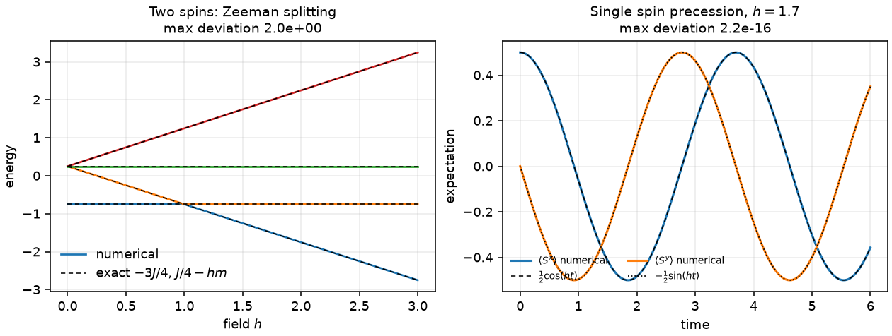
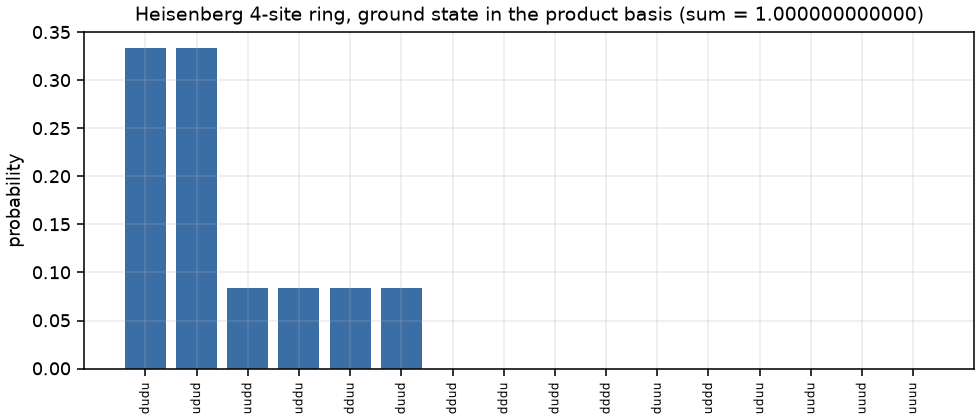

# 1. Quantum spin systems

Hamiltonians, eigenvalues and state probabilities for small spin chains, with
every structural claim checked against the operator algebra.

## Derivation

### Spin operators from the ladder operators

For a spin-`s` the states `|s, m⟩` with `m = s, s−1, …, −s` span a space of
dimension `2s + 1`. The ladder operators act as

```
S± |s, m⟩ = ħ √( s(s+1) − m(m±1) ) |s, m±1⟩
```

and the Cartesian components follow:

```
Sz = diag(s, s−1, …, −s)
Sx = (S+ + S−) / 2
Sy = (S+ − S−) / 2i
```

Setting `ħ = 1`. Building `Sx` and `Sy` this way rather than writing their
entries out is a deliberate choice: the SU(2) algebra

```
[Sx, Sy] = i Sz,   [Sy, Sz] = i Sx,   [Sz, Sx] = i Sy,   S² = s(s+1)·1
```

then holds by construction, and the test suite is confirming the matrix
arithmetic rather than a transcription. Measured deviations run from exactly
zero at `s = 1/2` to `1.6e-15` at `s = 3`.

For `s = 1/2` this reduces to half the Pauli matrices, which the suite also
checks directly.

### Many-body basis and operator embedding

An `n`-site chain lives in the tensor product, dimension `(2s+1)^n`. The
convention is that **site 0 is the most significant Kronecker factor**:

```
|m₀ m₁ … m_{n−1}⟩ = |m₀⟩ ⊗ |m₁⟩ ⊗ ⋯
```

so for spin-1/2 the basis index is the bit pattern with bit `n−1−i` holding
site `i`, and `0` means up. `basis_labels(n)` returns `['uu', 'ud', 'du',
'dd']` for `n = 2`, so nothing downstream depends on remembering this.

A single-site operator is embedded as

```
A_i = 1 ⊗ ⋯ ⊗ A ⊗ ⋯ ⊗ 1
```

with `A` in slot `i`.

### The Hamiltonian

```
H = J Σ_{⟨ij⟩} ( Δx Sˣ_i Sˣ_j + Δy Sʸ_i Sʸ_j + Δz Sᶻ_i Sᶻ_j )  −  h Σ_i Sᶻ_i
```

`anisotropy = (1,1,1)` is the isotropic Heisenberg model, `(0,0,1)` the Ising
model, `(1,1,0)` the XY model. The field carries a minus sign so positive `h`
lowers the energy of the up state.

**The two-site ring is refused, not guessed.** With `periodic=True` and
`n_sites = 2`, the wrap bond joins the same pair as the open bond. A ring
either has one bond (identical to the open chain) or two (double the coupling),
and silently picking one is how a factor of two reaches a published number. The
function raises and asks the caller to say which they mean.

### Exact results used as checks

**One spin in a field.** `H = −h Sᶻ` gives `E = ∓h/2`. Measured error: exactly
zero at `h = 0.5, 2, 7.3`.

**Two spins.** Using `S_tot² = S₁² + S₂² + 2 S₁·S₂` with `S₁² = S₂² = 3/4`,

```
S₁·S₂ = ½ ( S_tot² − 3/2 )
```

So `H = J S₁·S₂` has eigenvalues `−3J/4` for the singlet (`S_tot = 0`) and
`+J/4` for the triplet (`S_tot = 1`, threefold). Adding a uniform field splits
the triplet linearly:

```
E = J/4 − h·m,    m ∈ {−1, 0, +1}
```

Measured error over `J ∈ {1, 2.5, −1}` and `h ∈ {0, 0.6, 2.4}`: at most
`1.1e-16`. The singlet is confirmed to be `(|ud⟩ − |du⟩)/√2` with `⟨S²⟩ = 0`,
and each triplet state to have `⟨S²⟩ = 2`.

**Traceless at zero field.** `tr(Sᵃ_i Sᵃ_j) = 0` for `i ≠ j`, so a zero-field
chain has `tr H = 0` exactly, at every size. This catches an embedding error
that a spectrum check might miss.

## Symmetry: the claim that was wrong

The isotropic model commutes with the total spin:

```
[H, S²] = 0    and    [H, Sᶻ_tot] = 0
```

An early version of this document asserted that a uniform field along `z`
breaks the first of these. **It does not.** `S²` commutes with every component
of the total spin, including `Sᶻ_tot`, so the Zeeman term commutes with `S²` as
well. The measured commutator with `h = 0.7` is `4.4e-16`: zero.

What the field does is lift the degeneracy *inside* a multiplet. The spectrum
changes; the symmetry label does not. `S²` remains a good quantum number, which
is exactly why the Zeeman splitting can be written as `J/4 − hm` with `m` still
meaningful.

Two things genuinely do break it, and both are tested:

* **anisotropic exchange**: XXZ with `Δz ≠ 1`, Ising, XY. Measured `|[H, S²]|`
  of 0.5 to 1.0, while `[H, Sᶻ_tot] = 0` survives;
* **a site-dependent field**: a staggered `(−1)^i h Sᶻ_i` term. The Zeeman
  operator is then no longer proportional to `Sᶻ_tot`.

The distinction matters for block-diagonalisation: a code that assumes `S²`
blocks survive a Zeeman field is right, and one that assumes they survive an
XXZ anisotropy is wrong.

## Time evolution

```
|ψ(t)⟩ = e^{−iHt} |ψ(0)⟩ = Σ_k e^{−iE_k t} |k⟩⟨k|ψ(0)⟩
```

Applied through the eigenbasis, not by a series expansion or a time-stepping
scheme. This is exact to round-off at every `t` and has **no step-size error at
all**: a point worth making explicitly, because it is the reason this module
has no convergence study.

Verified against the closed-form precession of a spin initially along `+x` in a
field along `+z`:

```
⟨Sˣ⟩ = ½ cos(ht),   ⟨Sʸ⟩ = −½ sin(ht)
```

Measured deviation over 201 time points: `3.9e-16`. Norm preservation over the
same grid: `2.2e-16`.

## Thermal states

```
ρ = e^{−βH} / Z
```

built in the eigenbasis, with the energies shifted by the ground state before
exponentiating. The shift cancels exactly in the ratio and is what keeps
`exp(−βE)` from overflowing: at `β = 500` on a four-site chain the unshifted
form overflows a double, and the shifted one does not. Checks: unit trace,
hermiticity, positivity, the `β → ∞` limit as the ground-state projector, and
the `β → 0` limit as `1/dim`.

## Figures



*Left:* the two-spin spectrum as a function of field, with the closed form
`−3J/4` and `J/4 − hm` overlaid. *Right:* the precession of `⟨Sˣ⟩` and `⟨Sʸ⟩`
against `½cos(ht)` and `−½sin(ht)`.



Ground-state probabilities of a four-site Heisenberg ring in the product basis.
The weight sits entirely on the eight states with `Sᶻ_tot = 0`, as the `U(1)`
symmetry requires, and the probabilities sum to 1 to twelve decimal places.

## Limitations

* Exact diagonalisation only. Memory is `O(4^n)` for spin-1/2, so `n ≈ 14` is
  the practical ceiling; nothing here is a substitute for DMRG or QMC.
* Uniform couplings only: no disorder, no long-range interaction.
* Zero temperature dynamics; no open-system evolution.
