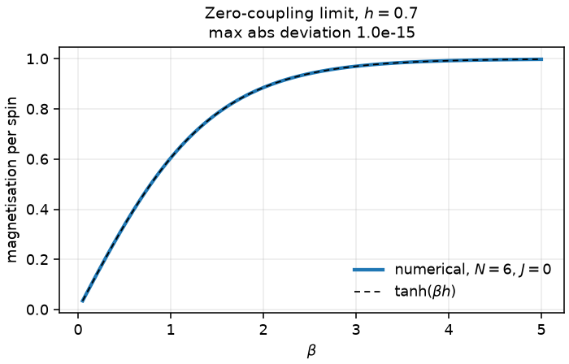

# 2. Statistical physics of small spin systems

Partition functions and thermodynamic observables, computed two independent
ways and checked against four limits.

## Derivation

### The ensemble

With `k_B = 1` and `β = 1/T`,

```
Z = Σ_i g_i e^{−βE_i}
F = −(1/β) ln Z
U = ⟨E⟩ = Σ_i p_i E_i,         p_i = g_i e^{−βE_i} / Z
C = β² ( ⟨E²⟩ − ⟨E⟩² )
S = β (U − F) = −Σ_i p_i ln p_i
```

The heat capacity follows from differentiating `ln Z` twice:

```
U = −∂(ln Z)/∂β,     C = ∂U/∂T = β² ∂²(ln Z)/∂β²  = β² Var(E)
```

so `C = β² Var(E)` and `C = dU/dT` are the same quantity by two derivations.
The module computes both, and their agreement is a real check: see below.

### The Ising ring

```
E({s}) = −J Σ_{⟨ij⟩} s_i s_j − h Σ_i s_i,     s_i = ±1
```

Positive `J` is ferromagnetic; positive `h` favours `s_i = +1`. With
`periodic=True` the ring has exactly `N` bonds, `i → i+1 mod N`.

### Method A: enumeration

Build all `2^N` configurations, evaluate `E` and the magnetisation for each,
and sum. Exact for any `N` small enough to enumerate, any boundary condition
and any field. The module refuses above `N = 22`.

### Method B: transfer matrix

Write `Z` as a trace of a product of 2×2 matrices. With the symmetric splitting
of the field between neighbouring sites,

```
T_{s s'} = exp[ βJ s s' + ½ βh (s + s') ]

T = [ e^{β(J+h)}   e^{−βJ}    ]
    [ e^{−βJ}      e^{β(J−h)} ]
```

so that `Z = tr T^N = λ₊^N + λ₋^N` with

```
λ± = e^{βJ} cosh(βh) ± √( e^{2βJ} sinh²(βh) + e^{−2βJ} )
```

The cost is independent of `N`, so this route reaches sizes enumeration cannot.

## The N = 2 convention, and why it matters

The two methods disagreed by up to 90 % at `N = 2` in the first version of this
module: and only at `N = 2`.

The cause is not a bug in either formula. `tr T^N` counts exactly `N` bonds, so
at `N = 2` sites 0 and 1 are bonded **twice**. The enumeration had been written
to skip the wrap bond at `N = 2` on the grounds that it joins the same pair,
giving a one-bond model. Both are defensible models; they are not the same
model, and the ground-state energy differs by a factor of two (`E₀ = −2J`
against `−J`).

The library now uses the `N`-bond ring convention everywhere, which is what
makes the two methods agree at every size. `quantum_spin.heisenberg_chain`
faces the same ambiguity and **raises** instead, because there the wrap bond
would double `J` in a way that is easy to miss in a published number.

This is the clearest argument in the repository for computing things twice: a
convention mismatch is invisible to any amount of testing against one method.

## Numerical stability

`ln Z` is accumulated with the log-sum-exp shift

```
ln Σ_i e^{−βE_i} = −βE_min + ln Σ_i e^{−β(E_i − E_min)}
```

so no term exceeds 1 before summation. Without it, `β = 50` on a system with
`E_min = −20` asks for `exp(1000)` and overflows. The same shift is applied
inside every observable.

Two further points:

* **The heat capacity takes the variance about the mean.** At low temperature
  `⟨E²⟩` and `⟨E⟩²` agree to many digits, and `⟨E²⟩ − ⟨E⟩²` loses that
  precision to cancellation: the same failure as the one-pass variance formula.
  `⟨(E − U)²⟩` keeps every term on the scale of the fluctuation.
* **`λ₊^N` overflows for long chains.** `ln Z` is computed as `N ln λ₊ +
  ln1p[(λ₋/λ₊)^N]`. The ratio is bounded by 1 by construction, so its `N`-th
  power underflows harmlessly to zero, and the sign is carried explicitly for
  antiferromagnetic `J` where `λ₋ < 0`. At `N = 1000, β = 2` this is finite
  where the direct form is not.

## Verification results

### Two independent methods

Over **384 parameter combinations** (`N ∈ {2,…,12}`, `h ∈ {0, 0.25, 1.0,
−0.6}`, `J ∈ {1, −1, 0.4}`, `β ∈ {0.05, 0.4, 1.5, 6.0}`) the worst relative
disagreement in `ln Z` is **2.4e-13**.

### Limiting cases

| limit | expected | measured |
|---|---|---|
| `T → ∞`: `S → N ln 2` | `N ln 2` | rel. error ≤ 2.1e-16 |
| `T → ∞`: `U → 0`, `C → 0` | 0 | ≤ 1e-6, ≤ 1e-10 |
| `T → 0`: `U → E₀` | `−N` | rel. error ≤ 1e-12 |
| `T → 0`, `h = 0`: `S → ln 2` | `ln 2` | rel. error 3.8e-14 |
| `T → 0`, `h ≠ 0`: `S → 0` | 0 | ≤ 1e-9 |
| `J = 0`: `m = tanh(βh)` | exact | rel. error ≤ 1.4e-16 |
| `J = 0`: `Z = [2cosh(βh)]^N` | exact | rel. error ≤ 1e-12 |

The low-temperature entropy tending to `ln 2` rather than zero is worth pausing
on: at zero field the ferromagnetic ground state is two-fold degenerate (all
up, all down), and the residual entropy is `ln g₀`. Switching on a field makes
the ground state unique and the entropy goes to zero instead. A suite that only
checked `S → 0` would have been wrong half the time.

### Thermodynamic consistency

`C = β² Var(E)` against `C = dU/dT` by centred difference, `N = 8`, `h = 0.3`:

| β | fluctuations | dU/dT | relative difference |
|---|---|---|---|
| 0.3 | 0.931166398 | 0.931166410 | 1.2e-08 |
| 1.0 | 4.087732195 | 4.087732152 | 1.1e-08 |
| 3.0 | 0.002073781 | 0.002073785 | 1.9e-06 |

The residual is the truncation error of the finite difference, and it grows as
`C` itself becomes small: a relative measure against a vanishing quantity. It
is not a disagreement between the two identities.

## Figures


*Left:* `ln Z` from enumeration and from the transfer matrix, indistinguishable
at this scale. *Centre:* `U` and `S` against temperature with `E₀`, `N ln 2`
and `ln 2` marked. *Right:* the heat capacity from the fluctuation formula and
from `dU/dT`.



Zero-coupling magnetisation against `tanh(βh)`.

## Limitations

* One dimension only. There is no phase transition at finite `T` in the 1-D
  Ising model, so nothing here exercises critical behaviour.
* Enumeration is capped at `N = 22`; the transfer matrix covers the periodic
  chain only.
* Classical spins. The quantum partition function would need the spectrum from
  `quantum_spin`, which is a straightforward composition but is not wired up.
