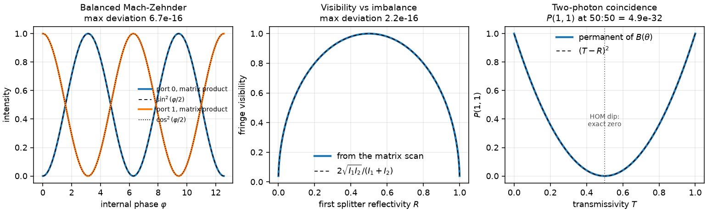

# 3. Photonics: beam splitters, phases and interference

Linear optics as matrix algebra, where unitarity does most of the verification
and two closed forms do the rest.

## Derivation

### Amplitudes and components

A two-mode state is a complex amplitude vector `(a₁, a₂)`, intensity is
`|aᵢ|²`, and every component is a 2×2 matrix acting on it. For a lossless
component,

```
Σᵢ |a'ᵢ|² = Σᵢ |aᵢ|²    for every input   ⟺   U†U = 1
```

**Energy conservation and unitarity are the same statement**, which is why a
single check covers both. Measured over every splitter, phase shifter and
interferometer in the module: `max |U†U − 1| = 2.2e-16`.

### The symmetric beam splitter

```
B(θ, φ) = [  cos θ            i e^{−iφ} sin θ ]
          [  i e^{iφ} sin θ   cos θ           ]
```

with transmissivity `T = cos²θ` and reflectivity `R = sin²θ`, so `T + R = 1`.

The factor of `i` on reflection is not a convention one is free to drop. For a
**symmetric lossless** splitter, unitarity forces the reflected and transmitted
amplitudes to differ in phase by `π/2`: writing `B = [[t, r],[r, t]]` and
imposing `B†B = 1` gives `|t|² + |r|² = 1` and `t*r + r*t* = 0`, i.e. `Re(t*r)
= 0`. The module asserts this directly: the measured relative phase is `π/2` to
`1e-12`.

At `θ = π/4` this is the familiar

```
B = (1/√2) [ 1  i ]
           [ i  1 ]
```

### Cascades

`cascade(A, B)` is `B @ A`: the first argument is the component the light meets
first. Stating this is not pedantry: for two symmetric splitters the order is
invisible, and for a splitter and a phase shifter it is a factor-of-everything
error. The suite checks both that `cascade(A, B) == B @ A` and that a splitter
and a phase shifter visibly do **not** commute.

### The Mach-Zehnder interferometer

Splitter, phase `φ` in one arm, splitter. With both splitters balanced,

```
B P(φ) B = ½ [ e^{iφ} − 1      i(e^{iφ} + 1) ]
             [ i(e^{iφ} + 1)   1 − e^{iφ}    ]
```

Input `(1, 0)` gives output amplitudes `½(e^{iφ} − 1, i(e^{iφ} + 1))`, and

```
I₀ = |e^{iφ} − 1|² / 4 = (2 − 2cos φ)/4 = sin²(φ/2)
I₁ = |e^{iφ} + 1|² / 4 = (2 + 2cos φ)/4 = cos²(φ/2)
```

with `I₀ + I₁ = 1`. Measured against the matrix product over 401 phases
spanning `4π`: **max deviation 4.4e-16**, with the total intensity holding to
`3.3e-16`.

So `φ = 0` is dark at port 0 and bright at port 1, and `φ = π` is the reverse.

### Visibility and imbalance

Two-beam interference of intensities `I₁, I₂` gives `I = I₁ + I₂ + 2√(I₁I₂) cos
φ`, hence

```
V = (I_max − I_min)/(I_max + I_min) = 2√(I₁I₂) / (I₁ + I₂)
```

Unbalancing the **first** splitter sends `I₁ = cos²θ` and `I₂ = sin²θ` down the
two arms, so the closed form predicts the visibility of the fringe. Measured
against the matrix scan at `θ_in ∈ {0.15, 0.4, π/4, 0.6, 1.2}`: **max deviation
4.0e-16**. Balanced gives `V = 1`; a fully reflecting first splitter gives `V =
0`, since there is nothing to interfere with.

### Two-photon interference

With creation operators transforming as `a_j† → Σᵢ U_{ij} cᵢ†`, the input `a₁†
a₂† |0⟩` becomes

```
(Σᵢ U_{i1} cᵢ†)(Σⱼ U_{j2} cⱼ†) |0⟩
```

Using `c†²|0⟩ = √2 |2,0⟩` and `c₁†c₂†|0⟩ = |1,1⟩`:

```
A(2,0) = √2 U₁₁ U₁₂
A(1,1) = U₁₁ U₂₂ + U₂₁ U₁₂        ← the permanent of U
A(0,2) = √2 U₂₁ U₂₂
```

For a unitary `U` these sum in probability to 1; measured deviation across the
full range of splitting ratios: `≤ 1.1e-16`.

**The Hong-Ou-Mandel dip.** For `B(θ, φ)` the permanent is

```
cos²θ + (i e^{iφ} sin θ)(i e^{−iφ} sin θ) = cos²θ − sin²θ = T − R
```

independently of `φ`. So

```
P(1,1) = (T − R)²
```

which is **exactly zero at 50:50**. Measured: `4.9e-32`: the square of a
cancellation at the level of machine epsilon.

This is the sharpest single test in the repository, and it is sharp precisely
because the answer is an algebraic zero rather than a small number. A
coincidence probability of `1e-4` would not be "close enough"; it would mean
the `π/2` reflection phase is wrong. The suite also confirms the dip is
unchanged by a phase shifter before the splitter, which only multiplies the
permanent by an overall factor.

## Verification summary

| check | kind | measured |
|---|---|---|
| `U†U = 1`, every component | exact identity | 2.2e-16 |
| MZI output vs `(sin²(φ/2), cos²(φ/2))` | closed form | 4.4e-16 |
| intensity sum vs 1 | exact identity | 3.3e-16 |
| `P(1,1)` vs `(T − R)²` | closed form | ≤ 1.1e-16 |
| HOM coincidence at 50:50 | algebraic zero | 4.9e-32 |
| visibility vs `2√(I₁I₂)/(I₁+I₂)` | closed form | ≤ 4.0e-16 |
| reflection phase vs `π/2` | forced by unitarity | 1e-12 |

Everything in this module is at round-off because nothing in it is discretised:
there is no step size, no truncation, and no iteration. That is worth stating
plainly rather than presenting `1e-16` as an achievement: the achievement would
be a module where the physics is right, and the identities above are what
establish that.

## Figures



*Left:* Mach-Zehnder fringes from the matrix product with `sin²(φ/2)` and
`cos²(φ/2)` overlaid. *Centre:* fringe visibility against first-splitter
reflectivity, matrix scan against the two-beam formula. *Right:* the
coincidence probability across the full range of splitting ratios, with the HOM
dip at `T = 1/2`.

## Limitations

* Two modes, lossless, monochromatic. No loss, no dispersion, no polarisation,
  no spectral or temporal mode structure: so the HOM dip here is the ideal
  zero, with no distinguishability to wash it out.
* The two-photon treatment uses the permanent formula for `n = 2` only. The
  general boson-sampling case needs permanents of `n × n` matrices and is
  `#P`-hard.
* No sources or detectors: the module computes amplitudes, not click statistics
  with efficiency and dark counts.
