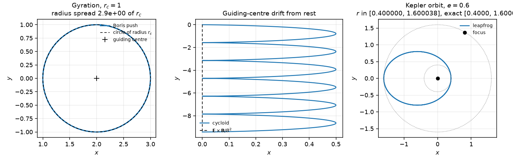
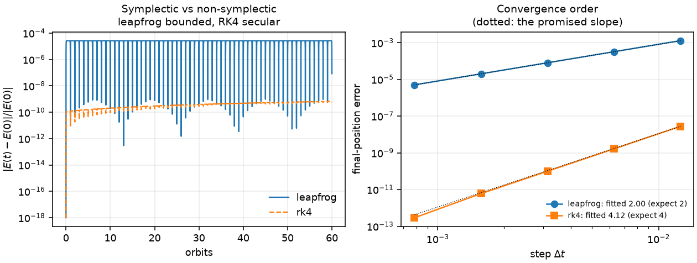

# 4. Trajectories: charged particles and the two-body problem

Two classical problems grouped because they are verified the same way — by
conserved quantities and closed forms, and by measuring the convergence order
rather than looking at the orbit.

## Part A: charged particle in electromagnetic fields

### The equation of motion

Non-relativistic Lorentz force:

```
m dv/dt = q ( E + v × B )
```

Three exact results serve as checks.

**Gyration.** With `E = 0` and uniform `B`, the force is always perpendicular
to `v`, so a magnetic field does no work and `|v|` is constant. The motion
perpendicular to `B` is a circle with

```
ω_c = |q| B / m,      r_c = m v⊥ / (|q| B)
```

and the velocity parallel to `B` is untouched, giving a helix.

**The guiding centre.** The particle does not orbit the origin, and it does not
orbit its starting point. The centre is

```
R = r + m (v × B) / (q B²)
```

one gyroradius away, on the side the Lorentz force points — which flips with
the sign of the charge. Starting at `[r_c, 0, 0]` with `v` along `+y` puts the
centre at `[2r_c, 0, 0]` for `q > 0` and at the origin for `q < 0`. Measuring
the orbit radius about the origin instead gives a spread of `2r_c`, which is
how a first version of this check appeared to fail; the function exists so the
gyroradius test is charge-agnostic.

**E × B drift.** With uniform perpendicular fields the guiding centre moves at

```
v_d = E × B / B²
```

independently of charge, mass and speed. The `q/m` dependence cancels, which
makes this a strong test of the whole integration rather than of one factor.

### The Boris push, and the arrangement that matters

The velocity update is standard: a half electric kick, a rotation of `v` about
`B`, and a second half kick. The rotation is applied as an **exact finite
rotation**,

```
t = (q Δt / 2m) B,       s = 2t / (1 + |t|²)
v' = v⁻ + v⁻ × t
v⁺ = v⁻ + v' × s
```

rather than as a derivative. The consequence is that for `E = 0` the speed is
conserved **at any step size**. Measured:

| steps per gyro-orbit | Boris rel. speed drift | RK4 rel. speed drift |
|---|---|---|
| 4 | 7.0e-15 | 5.5e-01 |
| 8 | 3.6e-15 | 3.4e-01 |
| 20 | 4.6e-15 | 5.3e-03 |
| 100 | 1.8e-15 | 1.7e-06 |
| 1000 | 1.8e-15 | 1.7e-12 |

At four steps per orbit RK4 loses 55 % of the speed and Boris loses nothing.
That is the property that makes the scheme standard in particle-in-cell work.

**Where the position goes matters as much as the rotation.** The first version
of this module advanced the position as `x += Δt·v_new`, after the velocity
update — an asymmetric arrangement. The symmetric one puts a half drift on
each side: drift, kick-rotate-kick, drift.

| arrangement | energy drift (E and B) | gyro-orbit radius spread |
|---|---|---|
| kick, kick, full drift | 1.5e-04 | 3.1e-03 of `r_c` |
| half drift, kick, half drift | **5.1e-14** | **3.1e-14** of `r_c` |

Ten orders of magnitude, from moving three lines. And note what did *not*
change: both arrangements measure a convergence order of exactly 2.000, so a
convergence study alone would have passed the asymmetric version. Only the
conserved quantities distinguish them. With the symmetric arrangement the
gyro-orbit is a circle of radius `r_c` to round-off.

## Part B: the gravitational two-body problem

### Reduction and conserved quantities

Two bodies interacting gravitationally reduce to a one-body problem in the
relative coordinate, with `μ = G(m₁ + m₂)`:

```
d²r/dt² = −μ r / r³
```

Conserved: the specific energy and the specific angular momentum,

```
ε = v²/2 − μ/r,        L = r × v
```

`L` is conserved because the force is central (`r × r = 0`), and its
conservation confines the motion to the initial plane — measured deviation out
of plane: `< 1e-15`.

### Orbital elements

From one state vector,

```
a = −μ / (2ε)
e = √( 1 + 2εL²/μ² )
r_peri = a(1 − e),    r_apo = a(1 + e)
T = 2π √(a³/μ)                       (Kepler's third law)
```

At periapsis, vis-viva gives `v_p = √( (μ/a)(1+e)/(1−e) )` perpendicular to
`r`. Round-tripping `(a, e) → state → (a, e)` over
`(1, 0), (1, 0.3), (2.5, 0.6), (0.4, 0.85)`: errors at or below `7.2e-16` in
`a`, `e`, `T` and `L`.

Unbound states are reported honestly: `ε ≥ 0` gives `bound=False` with infinite
apoapsis and period, rather than a silently wrapped number. At exactly the
escape speed the eccentricity comes out as 1 to `1e-12`.

### Symplectic versus accurate

Velocity Verlet (kick-drift-kick leapfrog) is symplectic and time-reversible.
RK4 is fourth-order and is neither. The difference is not about accuracy:

| orbits | leapfrog `dE/E` | RK4 `dE/E` | leapfrog `dL/L` | RK4 `dL/L` |
|---|---|---|---|---|
| 5 | 2.682e-05 | 1.540e-10 | 2.2e-14 | 7.2e-12 |
| 20 | 2.682e-05 | 2.932e-10 | 3.2e-14 | 2.9e-11 |
| 80 | 2.682e-05 | 8.501e-10 | 3.2e-14 | 1.1e-10 |
| 320 | **2.682e-05** | **3.078e-09** | 8.5e-14 | 4.6e-10 |

RK4 is five orders of magnitude more accurate at five orbits and its error
**grows linearly with time**. Leapfrog's is flat to four significant figures
from 5 orbits to 320: a symplectic map has no secular energy drift, only a
bounded `O(Δt²)` oscillation. Angular momentum splits the same way — leapfrog
holds it at round-off, because each kick is parallel to `r` and each drift is
parallel to `v`, so every sub-step preserves `x v_y − y v_x` exactly.

So "symplectic" and "accurate" are different properties, and which one matters
depends on the run: RK4 for a short high-accuracy integration, leapfrog when
the orbit must still be closed after 10⁶ periods. Both are provided so the
difference can be measured rather than asserted.

### Convergence orders

Fitted from the final-position error over one orbit at `e = 0.3`:

| integrator | expected | fitted | R² |
|---|---|---|---|
| leapfrog | 2 | 2.000 | 1.00000 |
| RK4 | 4 | 4.118 | 0.99979 |
| Boris | 2 | 2.000 | 1.00000 |

The error ratios between consecutive halvings are 4.00 for leapfrog and
16.5–20.6 for RK4, which is the direct reading of orders 2 and 4.

## Figures



*Left:* a gyro-orbit against the analytic circle of radius `r_c`, with the
guiding centre marked. *Centre:* the cycloid of a particle released from rest
in crossed fields, with the `E × B` drift line. *Right:* a Kepler orbit at
`e = 0.6` with `a(1∓e)` marked.



*Left:* relative energy error against time for both integrators over 60 orbits
— leapfrog oscillates under a flat ceiling, RK4's envelope climbs. *Right:* the
convergence study, with the promised slopes dotted.

## Limitations

* Uniform static fields only. No gradient-B or curvature drift, no
  self-consistent fields, no collisions.
* Non-relativistic. The Boris push has a well-known relativistic form; it is
  not implemented here.
* Two bodies only — no `N`-body, no softening, no adaptive stepping. The
  `e = 0.85` case is already where a fixed step starts to be wasteful, and a
  close encounter would need an adaptive or regularised scheme.
